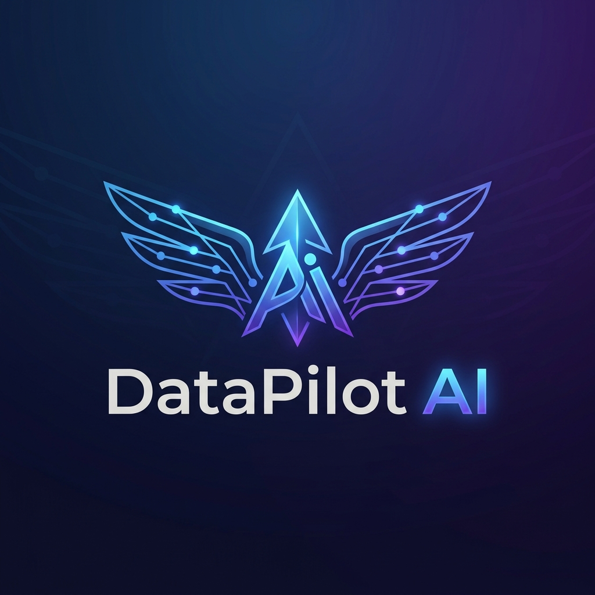
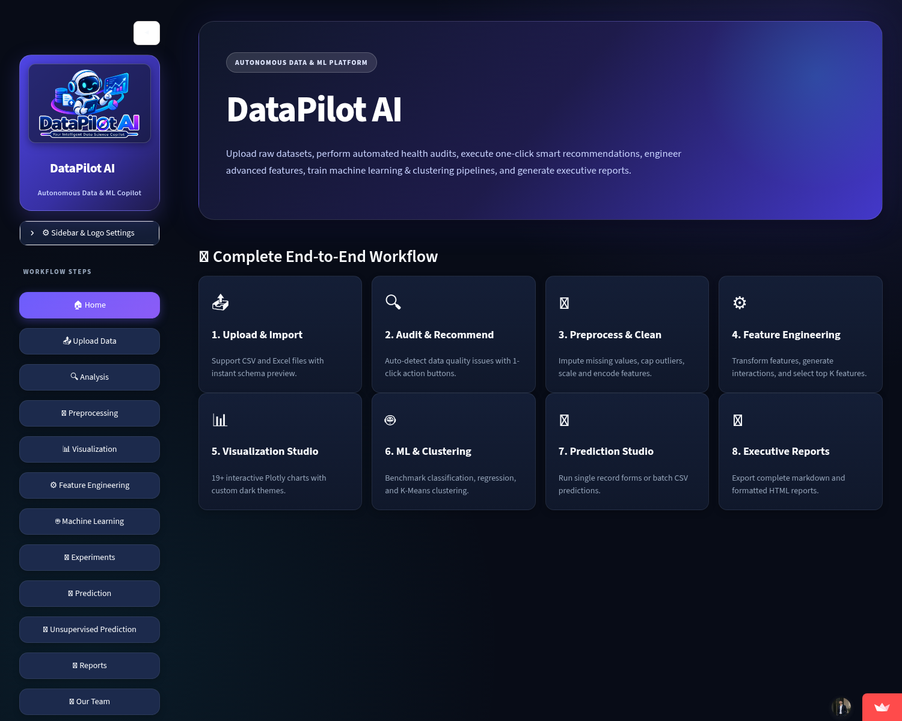
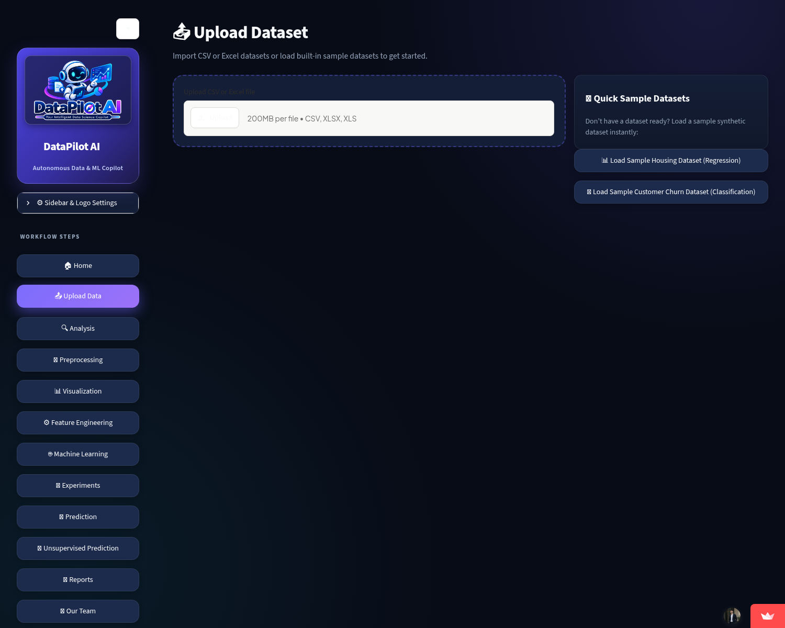

# DataPilot AI

An interactive data science workspace built with Python and Streamlit as an NTI final project.

[Open the hosted app](http://nti-final-project-data2piolt2ai.streamlit.app/) · [Application entry point](App.py)



## App Screenshots

Real captures from the [live deployed app](http://nti-final-project-data2piolt2ai.streamlit.app/):

**Home**



**Upload Dataset page**



## Problem Statement

Exploring data, cleaning it, comparing models and generating predictions often means switching between separate scripts. DataPilot AI brings these steps into one guided interface while keeping preprocessing and modeling choices visible to the user.

## Methodology

1. **Upload and inspect:** review the dataset, column types, missing values and duplicates.
2. **Analyze and prepare:** explore distributions and relationships, then choose preprocessing steps.
3. **Engineer features:** transform and select features for the chosen task.
4. **Train and compare:** run machine-learning experiments and compare the reported metrics.
5. **Predict and report:** use the selected workflow for predictions and export Markdown or HTML reports.

The navigation also includes an unsupervised-prediction page. The implementation is split between UI pages and reusable utilities rather than a single notebook.

## Insights

This is a reusable application, not an analysis of one fixed dataset. Findings and model scores depend on the uploaded data, target and experiment settings. No single accuracy or business-impact figure represents the whole platform.

- Review missingness and target distribution before choosing a model.
- Compare task-appropriate metrics, not accuracy alone.
- Check preprocessing and validation choices before interpreting the best experiment.

## Business Recommendations

- Use the app for exploratory analysis and model prototyping.
- Have a domain expert review generated findings before acting on them.
- Validate on unseen, representative data before considering operational use.
- Avoid uploading confidential data to a hosted demo without checking its data-handling arrangements.

These are proposed uses and safeguards, not measured business outcomes.

## Run Locally

```bash
git clone https://github.com/abdotamer55/NTI-Final-Project.git
cd NTI-Final-Project
python -m venv .venv
# Activate .venv for your operating system, then:
pip install -r requirements.txt
streamlit run App.py
```

## Repository Guide

| Path | Purpose |
| --- | --- |
| `App.py` | Streamlit entry point and page routing |
| `pages/` | Upload, analysis, preprocessing, visualization, modeling and reporting screens |
| `utils/` | Dataset analysis, preprocessing, feature engineering and prediction helpers |
| `src/` | Application state and shared UI |
| `styles/` | Application styling |
| `assets/images/` | Project artwork |

## Preview and Limitations

The image above is the existing project logo, not an application screenshot. The hosted-app link provides the interactive demo; availability depends on its hosting service. The repository does not include a verified application-screen capture.

Model quality is dataset-dependent. A trained model or generated report is not a guarantee of reliable decisions on new data.
